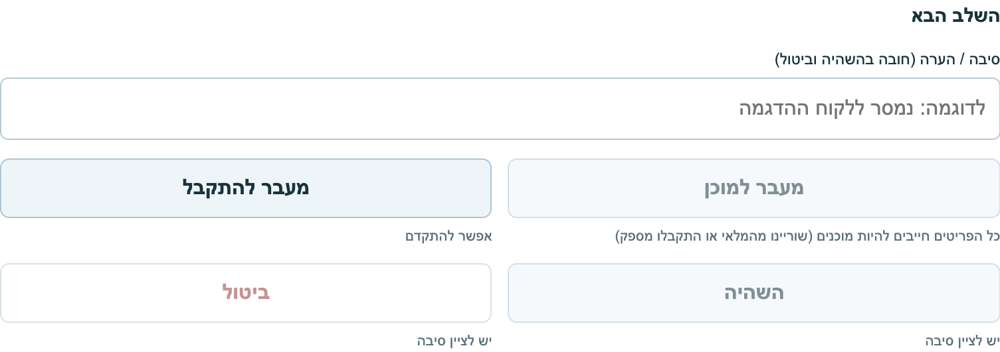
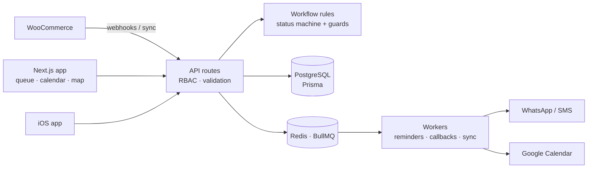

# OrdeX: Order Management System

OrdeX is an order-management system I built for a wallpaper-installation business: intake, preparation, scheduling, payment and delivery. This repository holds the full source code: the Next.js web app, the API, the workflow engine, background workers, integrations and the companion iOS app. It also includes a Hebrew RTL demo you can open with fictional orders.


**Try it:** download [`demo/index.html`](demo/index.html) and open it in a browser. It's one self-contained file with no install, network calls or accounts.

## The problem

In an installation business, an order can *look* ready to go while something is still missing: items not yet prepared, no delivery date, or an unpaid balance. Mistakes show up at the customer's door. The goal was a workflow that **won't let an order move forward until its prerequisites are met, and says exactly what's missing**.



## The system

A full-stack Next.js system I built over 14 months for Retzef, a wallpaper-installation business.

| | |
|---|---|
| **Scale** | 81 Prisma data models · 171 API routes · 171 test files · 1,750+ commits |
| **Core** | Order queue with calendar, kanban, map and list views · status automation through a rules engine · RBAC · Hebrew/English with RTL |
| **Integrations** | WooCommerce catalog sync and webhook order ingestion · WhatsApp and SMS (Twilio, Meta) · Google Calendar · Mapbox/Google Maps route planning |
| **Background work** | BullMQ workers on Redis for reminders, callbacks and sync jobs |
| **AI** | Gemini-based assistant for scheduling suggestions and data enrichment |
| **Ops** | PostgreSQL, Docker, staging/production environments, health checks and OpenTelemetry monitoring · a companion iOS app |




## Engineering decisions

| Decision | Why |
|---|---|
| **The workflow is an explicit state machine** ([`lib/status-machine.ts`](lib/status-machine.ts)) | Every allowed transition is listed in one place, so "can this order go from X to Y?" has a single, testable answer. In production the API routes and the workflow and status-recalculation services all call it. |
| **Guards return reasons, not booleans** ([`lib/status-guards.ts`](lib/status-guards.ts), [`lib/workflow-requirements.ts`](lib/workflow-requirements.ts)) | A blocked button that doesn't say why creates support calls. Each guard returns the missing prerequisites, such as unprepared items, no delivery date or an outstanding balance, and the UI shows them. |
| **Departure requires full payment and a date** | The most expensive mistake is a truck leaving for an unpaid or unscheduled job. The rule lives in the domain layer, not in a form. |
| **Legacy statuses map forward** ([`domain/status/legacyStatusMap.ts`](domain/status/legacyStatusMap.ts)) | The status model was redesigned while real orders existed. Old statuses still display and resolve to their new equivalents, but nothing can create them anymore. |
| **Rules are plain functions** | The workflow rules depend only on the Prisma status enum, not on Next.js or the database client, so API routes, workers and tests all call the same code. |

## What's in this repo

```
app/            Next.js App Router: pages and 171 API routes
components/     React UI (queue, calendar, kanban, map, dashboards)
lib/            Domain services, workflow rules, integrations (WooCommerce, Twilio, Google)
domain/         Status model and legacy mapping
workers/        BullMQ background jobs
prisma/         Schema (81 models) and migrations
tests/          Vitest unit and integration tests, Playwright e2e
ios/            OrdexApp: SwiftUI companion app (XcodeGen project)
infra/          Local WooCommerce test store (WordPress Playground)
k8s/            Kubernetes manifests (example secrets only)
docs/release/   Release, deployment and tenant-isolation notes
demo/           Single-file portfolio demo with fictional orders
```


## Run it locally

Requires Node.js 22, PostgreSQL and Redis. Every integration key is optional for local development.

```bash
npm ci
cp .env.example .env          # fill in DATABASE_URL, REDIS_URL and AUTH_JWT_SECRET
npx prisma migrate deploy
npm run seed                  # fictional demo data
npm run dev                   # http://localhost:3000
```

```bash
npm test                      # Vitest
npm run typecheck
npm run test:smoke            # Playwright smoke test
```

`docker compose -f docker-compose.dev.yml up -d` starts PostgreSQL and Redis. [`docs/release/local-demo.md`](docs/release/local-demo.md) describes the full local pilot demo, including a WooCommerce test store.

**iOS:** `cd ios && xcodegen generate`, then open `OrdexApp.xcodeproj`.

**A walk through the single-file demo** ([`demo/index.html`](demo/index.html)):
1. Pick an order and move it to **בטיפול** (in progress).
2. Try **מוכן** (ready). It's blocked until the items are marked as prepared.
3. Try **בדרך** (out for delivery). It's blocked until a delivery date is set and payment is confirmed.
4. Complete the order and look at its action history.


## How I built it

I designed the domain model, the workflow rules and the integrations, and I own the codebase. For implementation I worked with AI coding agents (Claude Code, Google Jules, Cursor) as contributors: I wrote the specs and acceptance criteria and reviewed every change. About 1,300 of the 1,750+ commits are my own.

## Boundaries

All demo and seed data is fictional. No credentials are committed: configuration comes from environment variables (see `.env.example`), and the repository is scanned with gitleaks in CI.

**Rights:** all rights reserved. The source is published for portfolio review, and no open-source license is granted.

The repository was published as a clean snapshot of the production codebase. The development history (1,750+ commits) stays private.
