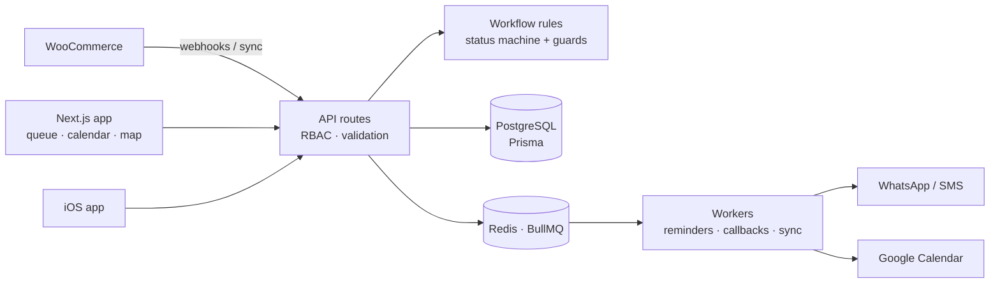

# OrdeX: Order Workflow Engine

OrdeX is an order-management system I built for a wallpaper-installation business: intake, preparation, scheduling, payment and delivery. This repository is the public slice of it. It contains the workflow rules extracted from the production codebase, their tests, and a Hebrew RTL demo you can run with fictional orders.


**Try it:** download [`demo/index.html`](demo/index.html) and open it in a browser. It's one self-contained file with no install, network calls or accounts.

## The problem

In an installation business, an order can *look* ready to go while something is still missing: items not yet prepared, no delivery date, or an unpaid balance. Mistakes show up at the customer's door. The goal was a workflow that **won't let an order move forward until its prerequisites are met, and says exactly what's missing**.


## The full system (private)

The production codebase stays private because it holds business logic and integrations. It's a full-stack Next.js system, which I built over 14 months.

| | |
|---|---|
| **Scale** | 81 Prisma data models · 171 API routes · 171 test files · 1,750+ commits |
| **Core** | Order queue with calendar, kanban, map and list views · status automation through a rules engine · RBAC · Hebrew/English with RTL |
| **Integrations** | WooCommerce catalog sync and webhook order ingestion · WhatsApp and SMS (Twilio, Meta) · Google Calendar · Mapbox/Google Maps route planning |
| **Background work** | BullMQ workers on Redis for reminders, callbacks and sync jobs |
| **AI** | Gemini-based assistant for scheduling suggestions and data enrichment |
| **Ops** | PostgreSQL, Docker, staging/production environments, health checks and OpenTelemetry monitoring · a companion iOS app |



**In this repository:** the workflow rules (highlighted above) and their tests, plus a demo UI built only for this portfolio.

## Engineering decisions

| Decision | Why |
|---|---|
| **The workflow is an explicit state machine** ([`lib/status-machine.ts`](lib/status-machine.ts)) | Every allowed transition is listed in one place, so "can this order go from X to Y?" has a single, testable answer. In production the API routes and the workflow and status-recalculation services all call it. |
| **Guards return reasons, not booleans** ([`lib/status-guards.ts`](lib/status-guards.ts), [`lib/workflow-requirements.ts`](lib/workflow-requirements.ts)) | A blocked button that doesn't say why creates support calls. Each guard returns the missing prerequisites, such as unprepared items, no delivery date or an outstanding balance, and the UI shows them. |
| **Departure requires full payment and a date** | The most expensive mistake is a truck leaving for an unpaid or unscheduled job. The rule lives in the domain layer, not in a form. |
| **Legacy statuses map forward** ([`domain/status/legacyStatusMap.ts`](domain/status/legacyStatusMap.ts)) | The status model was redesigned while real orders existed. Old statuses still display and resolve to their new equivalents, but nothing can create them anymore. |
| **Rules have no framework dependencies** | In production they sit behind Prisma and Next.js. Here the same logic runs in a plain React demo and in Vitest without changes, apart from swapping the Prisma enums for TypeScript unions. |

## What's in this repo

| Part | Origin |
|---|---|
| Status machine, guards, requirement mapping, legacy map | Extracted from the production codebase. Prisma enums replaced with TypeScript types. |
| Workflow regression tests | Adapted from the production test suite |
| Demo UI, fictional orders, in-memory history | Built for this portfolio |

[`extraction-manifest.json`](extraction-manifest.json) records the source revision and a SHA-256 hash for every extracted file.

## Run it from source

Requires Node.js 22.12 or later. No API keys or database.

```bash
npm ci
npm run dev          # Vite dev server
npm test             # 40 unit tests: transitions, guards, payment, scheduling, hold/resume
npm run e2e          # Playwright: full flow, RTL, 390/768/1440 px, no external requests
npm run build:demo   # rebuilds the single-file demo/index.html
```

**A walk through the demo:**
1. Pick an order and move it to **בטיפול** (in progress).
2. Try **מוכן** (ready). It's blocked until the items are marked as prepared.
3. Try **בדרך** (out for delivery). It's blocked until a delivery date is set and payment is confirmed.
4. Complete the order and look at its action history.

## How I built it

I designed the domain model, the workflow rules and the integrations, and I own the codebase. For implementation I worked with AI coding agents (Claude Code, Google Jules, Cursor) as contributors: I wrote the specs and acceptance criteria and reviewed every change. About 1,300 of the 1,750+ commits are my own.

## Boundaries

All demo data is fictional. Payment in the demo is a toggle: no charge or payment provider is involved. The demo has no backend, authentication or integrations, and isn't meant for real customer data.

**Rights:** all rights reserved. The source is published for portfolio review, and no open-source license is granted.
