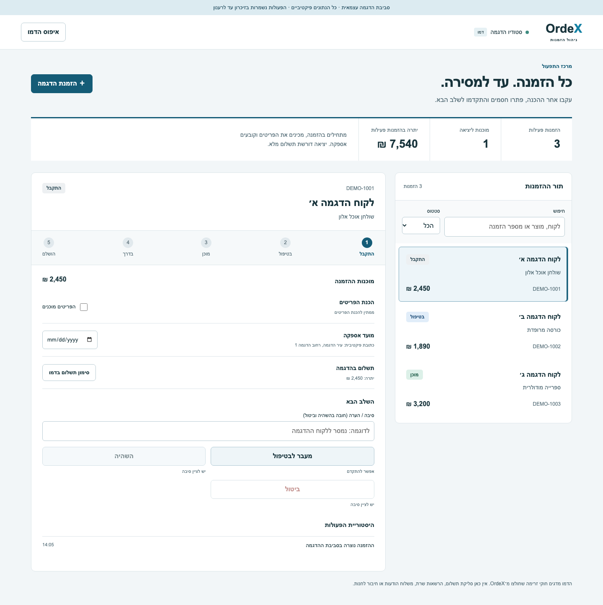

# OrdeX — דמו לניהול הזמנות

דמו עצמאי בעברית המדגים את הליבה התפעולית של OrdeX: מהזמנה חדשה ועד למסירה, עם חסמים ברורים והיסטוריית פעולות.
נבנה לפורטפוליו באמצעות חילוץ חוקי זרימה מהפרויקט המקורי והוספת ממשק הדגמה ייעודי.



## הרצה מקומית

נדרשים Node.js 22.12+ ו־npm. אין צורך במפתחות API, בקובץ סביבה או במסד נתונים.

```bash
npm ci --ignore-scripts
npm run dev
```

פתחו את כתובת localhost שמודפסת במסוף. בהתקנה הראשונה נדרש אינטרנט להורדת התלויות; בזמן השימוש אין חיבור לספקים חיצוניים.

```bash
npm run build       # בדיקת TypeScript ובניית אתר סטטי
npm run preview     # תצוגה מקומית של הבנייה
npm test            # בדיקות לוגיקה
npx playwright install chromium
npm run e2e         # בדיקות ממשק בדפדפן
```

## מה אפשר לנסות

1. בחרו הזמנה ולחצו על מעבר ל״בטיפול״.
2. נסו לעבור ל״מוכן״: ההסבר מציג מה חסר. סמנו שהפריטים מוכנים והתקדמו.
3. נסו לצאת לדרך לפני קביעת מועד וסימון תשלום מלא בדמו.
4. קבעו תאריך, סמנו תשלום בדמו, צאו לדרך והשלימו את ההזמנה.
5. בדקו את היסטוריית הפעולות. נסו גם השהיה עם סיבה וחזרה למצב הקודם.
6. צרו הזמנת הדגמה, חפשו לפי לקוח או מוצר, ואפסו את הנתונים.

## תכולה ומגבלות

- נתונים פיקטיביים בלבד, שנשמרים בזיכרון הדפדפן עד לרענון. אין שמירה מקומית מתמשכת.
- היציאה למשלוח או להתקנה דורשת מועד ותשלום מלא. הכנת כל הפריטים וכתובת מלאה נדרשות לפני ״מוכן״.
- התשלום הוא סימון לצורך הדגמה בלבד; אין סליקה, קבלה או גבייה.
- הממשק חדש וממוקד בפורטפוליו; הוא אינו עותק של כל מסכי המערכת המקורית.
- אין שרת, התחברות, הרשאות, הפרדת עסקים, WooCommerce, תורים, AI, מפות או משלוח הודעות. הדמו אינו מיועד לנתוני לקוחות אמיתיים.
- כללי הזרימה כוללים מטא־דאטה היסטורי לפעולות אוטומטיות. הדמו אינו מפעיל אותן.
- הקוד המקורי כולל סטטוסים ישנים; הם נשמרו במודולי הליבה כדי לשמור על התאימות, ואינם מוצעים ליצירה בממשק.

## מקור וארכיטקטורה

`lib/orderStatus.ts`, `lib/status-machine.ts`, `lib/status-guards.ts` ו־`lib/workflow-requirements.ts` חולצו מהמערכת המקורית, יחד עם מיפוי סטטוסים ובדיקות ממוקדות. תלות Prisma הוחלפה באובייקט קבוע ובטיפוס string union עם אותם ערכים.

`src/demo.ts` מחבר את חוקי הליבה לפעולות הדמו, כולל שמירת המצב שלפני השהיה והיסטוריה בזיכרון. `src/main.tsx` מציג תור הזמנות ופרטי הזמנה ב־React. הבנייה באמצעות Vite מפיקה אתר סטטי.

[מפת החילוץ](extraction-manifest.json) כוללת רשימת קובצי המקור, טביעות SHA-256 וקומיט הבסיס. היסטוריית Git, קובצי סביבה, נתוני מערכת, תוצרי בנייה והיסטוריית שיחות מהמקור לא הועתקו.

## בדיקות ואבטחת הפרסום

40 בדיקות לוגיקה מכסות מעברים מותרים וחסומים, הכנת פריטים, תשלום, תזמון, השהיה ואיפוס. בדיקות Playwright מכסות את הזרימה המלאה, יצירה וחיפוש, שיח יצירה, RTL ורוחבי 390/768/1440. בדיקת הזרימה מוודאת גם שאין בקשות לספקים חיצוניים או שגיאות JavaScript.

[גבולות הבדיקה](docs/publication-review.md) מפרטים מה נבדק לפני הפרסום. ריפו ציבורי אינו אישור למוכנות המערכת המקורית לייצור.

## זכויות שימוש

כל הזכויות שמורות. פרסום הקוד נועד לעיון בפורטפוליו; לא הוענק רישיון קוד פתוח.
